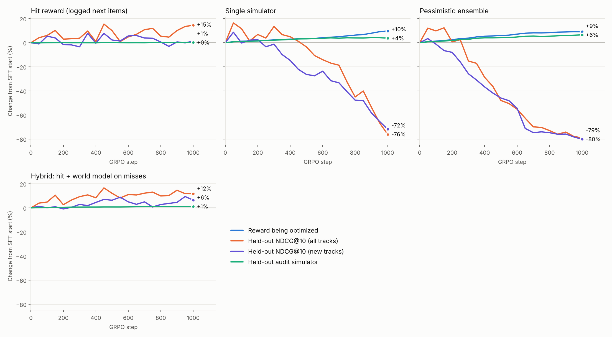
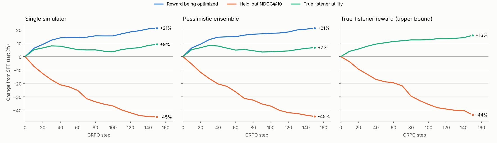
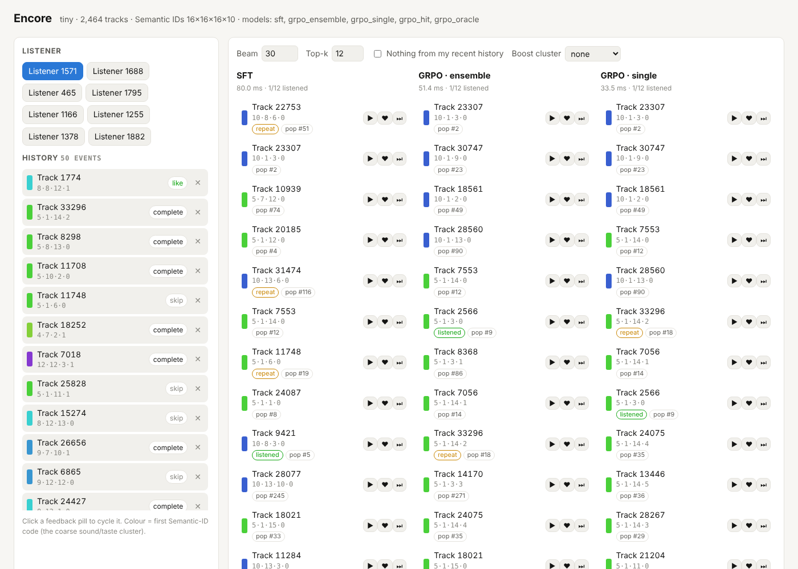

# Encore

**Generative music recommendation on Semantic IDs, post-trained with GRPO against a pessimistic ensemble of listener world models.**

A transformer recommends tracks by *writing their Semantic IDs* token by token, the way a language model writes words. It is then improved with reinforcement learning (GRPO).

Two open problems in RL for generative recommenders motivate the design:

- **Zero rewards.** A reward of "did the user play this exact track next?" is almost always 0, so most GRPO groups carry no gradient.
- **Simulator exploitation.** A policy trained against one learned user simulator learns that simulator's blind spots.

Encore's answer is an ensemble of **listener world models** that score any (history, track) pair, combined pessimistically as mean − λ·std (the MOPO trick). The repo implements that idea and the baselines it has to beat. It also includes a synthetic world with a **hidden true listener**, so you can measure whether a policy actually got better or only fooled its simulator.

**Short version of what the experiments found:**
- On real listening data, a no-training "replay your favourites" baseline beats every model on the standard metric, because most of what people play is music they already know.
- The Semantic-ID generator beats SASRec and the two-tower on that metric, but it gets there through repeats. On tracks that are new to the listener, it trails both.
- Dense world-model rewards reward-hack within a few hundred GRPO steps, and a held-out audit model does not notice. Ensemble pessimism does not prevent this, on synthetic or real data.
- What does work: the sparse hit reward (+13% NDCG), and a hybrid reward that is just as good while staying stable.

## Results on Yambda-50M (real data, RTX 4090 laptop)

Yambda-50M from Yandex Music, after filtering:
- 8,917 listeners, 45.0M listens over 301 days.
- 283,853 tracks, 9,099 of them cold (first heard in the held-out days).
- The last day is the test set: 4,582 listeners, 127k target tracks. Validation is the day before. 30-minute gaps separate the splits.
- Semantic IDs are 256×256×256 plus a dedup token.
- A full run, from raw data to the final evaluation, takes about 2.5 hours on a laptop RTX 4090.

Raw reports and GRPO logs are in [`results/yambda50m/`](results/yambda50m).

**Two evaluation views**, because repeat listening dominates music:
- **All tracks:** standard NDCG@10 over every track the listener completed on the test day.
- **New tracks:** a discovery view. Each model's recommendations exclude everything the listener has ever played, and targets are limited to tracks they had never played before. It covers 3,285 listeners.

| Model | NDCG@10, all tracks | Share of top-10 already played | **NDCG@10, new tracks** | Cold tracks: new-track recall@100 | Catalogue coverage@10 |
|---|---|---|---|---|---|
| Replay most-played recent tracks (no training) | **0.206** | 100% | — | — | 9.0% |
| Popularity | 0.023 | 27% | 0.010 | 0.000 | 0.0% |
| SASRec (15 epochs) | 0.085 | 81% | **0.033** | 0.000 | 4.1% |
| Two-tower, audio item tower (10 epochs) | 0.093 | 77% | 0.030 | **0.027** | 5.1% |
| Encore SFT generator | 0.142 | 76% | 0.019 | 0.012 | 7.3% |
| + GRPO, hit reward, 1000 steps | 0.161 | 80% | 0.019 | 0.013 | 7.3% |
| + GRPO, single world model, best checkpoint (step 50) | 0.165 | 84% | 0.019 | 0.014 | 7.4% |
| + GRPO, single world model, 1000 steps | 0.034 | 22% | 0.004 | 0.003 | 1.3% |
| + GRPO, pessimistic ensemble, best checkpoint (step 150) | 0.159 | 81% | 0.019 | 0.008 | 6.3% |
| + GRPO, pessimistic ensemble, 1000 steps | 0.032 | 24% | 0.004 | 0.002 | 0.9% |
| + GRPO, hybrid, best checkpoint (step 450) | 0.162 | 83% | 0.019 | 0.012 | 7.1% |
| + GRPO, hybrid, 1000 steps | 0.156 | 79% | 0.019 | 0.012 | 7.0% |

"Best checkpoint" means the step with the highest validation NDCG (all tracks); checkpoints were evaluated every 50 steps.



What this shows:

1. **Repeat listening dominates the standard metric.**
   - About a third of each listener's test-day tracks (median 17%) were already in their last 200 listens.
   - "Replay your most-played recent tracks" scores 0.206, ahead of every learned model.
   - Every learned model already fills 76–84% of its top 10 with tracks the listener has heard.
   - Reporting all-tracks NDCG alone would have credited the models for re-learning repeat behaviour.
2. **The generator wins on repeats and loses on discovery.**
   - All tracks: it beats the two-tower by 52% (0.142 vs 0.093).
   - New tracks: it trails SASRec by 43% (0.019 vs 0.033).
   - Cold tracks: it finds them, which SASRec cannot, but the audio-based two-tower is about twice as good (0.027 vs 0.012).
   - Two likely causes:
     - Training targets are dominated by repeats, which are easy to copy as Semantic-ID tokens.
     - Excluding played tracks only at the final token lets repeat-heavy prefixes crowd the beam.
   - Large dedup buckets (up to 199 tracks share a 3-code prefix) make that final token weak at telling unfamiliar tracks apart.
3. **The sparse hit reward works on real data.**
   - 74% of GRPO groups carry no signal.
   - The policy still improves test NDCG by 13% (0.142 → 0.161) with KL staying near 0.05.
   - The gain comes from repeats: the repeat share rose from 76% to 80%, and new-track NDCG did not move.
4. **Dense world-model rewards reward-hack, and the audit model misses it.**
   - For about 50–150 steps they look like the best option: the single-model checkpoint at step 50 is the best model overall at 0.165.
   - By step 1000, validation NDCG has fallen 76–79% and catalogue coverage has collapsed to 0.4%.
   - Meanwhile, the reward climbs 9–10% and a held-out audit world model, never used for training, reports +4% to +6%.
   - World-model AUCs are 0.88 (completion), 0.92 (like) and 0.89 (dislike), so these are good models being exploited, not bad ones.
5. **Pessimism (mean − λ·std over 5 members) did not help.**
   - The ensemble collapsed as badly as the single model: −79% vs −76% validation NDCG.
   - Its members agree on the tracks they all over-score, matching the synthetic result below.
6. **The hybrid reward is stable.**
   - It uses the hit reward, plus 0.5 × the pessimistic world-model score that only matters when no sample in a group hits, with an advantage-std floor of 0.1.
   - It matches the hit reward (0.156–0.162) and never collapses: KL stayed at 0.065, compared with 1.2–1.9 for the pure world-model rewards.
   - On validation it gave the only upward trend in new-track NDCG (+6% by step 1000). On test, that shrinks to +2%, which is within noise.

**Serving.** Trie-constrained beam search with KV-cache prefill runs on the 4090 laptop at:
- 18 ms p50 / 41 ms p99 for beam 50, batch 1;
- 187 listeners/s for beam 20, batch 32.

## Results on the synthetic testbed (CPU)

2,000 listeners, 2,464 tracks, 346k listens, Semantic IDs 16×16×16 plus a dedup token. Every number below was produced by `python -m encore pipeline --config configs/tiny.yaml`. Raw reports and GRPO logs are in [`results/synthetic_tiny/`](results/synthetic_tiny).



| Reward GRPO optimizes (150 steps, KL 0.1, 300 validation listeners) | Groups with no signal | Held-out NDCG@10 | **True listener utility** | Held-out audit model |
|---|---|---|---|---|
| Hit: logged next tracks | 86% | 0.0995 → 0.0979 | **−5.3%** | −0.4% |
| Single world model | 0% | 0.0995 → 0.0546 | **+9.2%** | +21.5% |
| Pessimistic ensemble, λ = 1 | 0% | 0.0995 → 0.0549 | **+6.7%** | +20.7% |
| Pessimistic ensemble, λ = 5 | 0% | 0.0995 → 0.0574 | **+5.1%** | +20.1% |
| True listener (upper bound) | 0% | 0.0995 → 0.0561 | **+15.9%** | +19.1% |

What this shows:

1. **The zero-reward problem is real, and graded world-model rewards fix it.** With the hit reward, 86% of groups have zero variance. That policy keeps NDCG flat while making listeners *less* happy. World-model rewards give signal in every group and raise true utility.
2. **The pessimistic ensemble did not beat a single simulator here.** This holds even with randomized-prior members (Osband et al.) and λ up to 5. The members' disagreement on generated tracks barely tracks their actual error (Spearman ρ = 0.06–0.09). They are all trained on the same logs, which only contain tracks the old system chose to show, so they share the same bias. Bootstrapping and random priors capture *variance*, not that *bias*. This is a clean negative result for variance-based pessimism. One seed per run, so gaps of a few points between the world-model rows are within noise. Running seeds 1–4 is a cheap next check.
3. **Held-out NDCG on logged data is a misleading guide for RL-tuned recommenders.** Optimizing the *true* listener still drops NDCG@10 by 44%. Logged NDCG rewards reproducing what the old system exposed, so it would have rejected every policy here that actually made listeners happier.
4. **A held-out audit simulator overstates gains** when the policy optimizes a world model (+21% claimed vs +9% real). It is close when the policy optimizes the truth (+19% vs +16%). The size of that gap is a symptom of exploitation, but you can only see it when ground truth exists.

Test-set comparison (1,000 held-out listeners, last 3 days):

| Model | NDCG@10 | Recall@10 | Cold-start recall@50 | Coverage@10 | True utility@10 |
|---|---|---|---|---|---|
| Popularity | 0.072 | 0.051 | 0.000 | 0.4% | 1.06 |
| SASRec | 0.113 | 0.082 | 0.000 | 3.7% | 1.54 |
| Two-tower (audio item tower) | **0.116** | **0.084** | **0.061** | **11.5%** | 1.61 |
| Encore SFT generator | 0.098 | 0.073 | 0.031 | 5.6% | 1.57 |
| + GRPO, single world model | 0.066 | 0.051 | 0.027 | 2.1% | **1.72** |
| + GRPO, pessimistic ensemble | 0.065 | 0.049 | 0.023 | 2.1% | 1.67 |
| + GRPO, true listener (upper bound) | 0.063 | 0.051 | 0.031 | 3.3% | 1.85 |

At this small scale the generator trails the two-tower and SASRec on logged accuracy. That matches published arguments that classic retrieval is hard to beat on raw accuracy. After world-model GRPO, though, it gives the best true listener utility of any deployable model (1.72 vs 1.61 for the two-tower). Serving cost: trie-constrained beam search with a shared KV-cache prefill runs at **23 ms p50 / 36 ms p99** for beam 50, batch 1, on 2 CPU cores.

**How the synthetic results held up on Yambda-50M.**
- Finding 1 held: the hit reward left 74% of groups with no signal. On real data, though, it still improved NDCG, because a well-trained generator lands real hits often enough.
- Finding 2 held: pessimism did not beat a single simulator.
- Finding 4 held more strongly: on real data the audit model kept reporting gains (+4–6%) while held-out NDCG collapsed (−76–79%).

## What's in the box

```
Yambda-50M (or a synthetic world with a hidden true listener)
   │
   ├─ prepare ── like/dislike labels, global temporal split (train · gap · val · gap · test), cold items
   │
   ├─ baselines ─ popularity · SASRec (full/sampled softmax) · two-tower (logQ, audio item tower)
   │
   ├─ sid ─────── audio PCA ⊕ collaborative embedding (SASRec or PPMI-SVD), ridge map audio→collab for cold items
   │              → RQ-KMeans (e.g. 256×256×256) + popularity-ordered dedup token → prefix trie
   │
   ├─ sft ─────── decoder-only transformer over SID tokens; listen feedback (skip/complete/like/dislike)
   │              injected on each item's last token; trie-constrained per-level softmax loss
   │
   ├─ world ───── N listener models: P(complete), E[play-through], P(like), P(dislike) for any (history, track)
   │              bootstrap over users + one held-out audit model; AUC / calibration / OOD report
   │
   ├─ collapse ── GRPO with five rewards: hit · single simulator · pessimistic ensemble · hybrid (hit + world model
   │              on misses) · oracle; KL to SFT, PPO clipping, diversity bonus, best-validation checkpointing
   │
   ├─ eval ────── two views: all tracks and new-to-listener tracks; replay-history baseline; repeat share,
   │              cold-start recall, coverage, intra-list diversity, novelty, true/simulated utility
   │
   └─ serve ───── FastAPI + KV-cached trie-constrained beam search, steering (exclude recent, boost cluster),
                  demo page, p50/p99 latency, Docker, CI
```

## Quickstart

```bash
pip install -e ".[dev]"                           # after installing PyTorch for your GPU
pytest                                            # 23 tests: KV cache, beam == exhaustive, trie, metrics
python -m encore pipeline --config configs/tiny.yaml
python -m encore serve --config configs/tiny.yaml # http://localhost:8000
```

Full step-by-step instructions, including the real Yambda-50M run on a single 16 GB GPU, are in **[docs/RUN_LOCALLY.md](docs/RUN_LOCALLY.md)**.



## How it works

### Data and evaluation protocol
- **Yambda-50M** (Yandex Music, Apache-2.0): listens with play-through %, likes, dislikes, an organic/recommended flag, and audio embeddings for 7.7M tracks.
- A listen is *complete* when play-through ≥ 50%. Likes and dislikes are attached to the nearest listen of the same track within an hour.
- **Global temporal split**: last day = test, the day before = validation, 30-minute gaps between splits. No user leaks future behaviour into training.
- Test targets are each user's distinct completed tracks in the test window. Histories are everything before it.
- Every model is scored twice:
  - **All tracks**, plus the share of its top 10 the listener has already played.
  - **New tracks only.** The listener's whole play history is excluded from the recommendations, and targets are limited to tracks they have never played. Exclusion happens inside the generator's beam search, and by masking scores in the other models.
- A "replay most-played recent tracks" baseline is always included, since it beats every learned model on the all-tracks view.
- Tracks first heard in the held-out windows are **cold**: they still get Semantic IDs from audio, so the generator can recommend them. ID-only SASRec cannot.

### Semantic IDs
- Each track's embedding fuses PCA-reduced audio with a collaborative vector (SASRec item embeddings by default, PPMI-SVD as an alternative).
- Tracks without collaborative signal get one predicted from audio with a ridge map, measured on held-out tracks.
- RQ-KMeans quantizes the residual level by level. A last *dedup* token separates collisions, ordered by popularity.
- `sid_report.json` records codebook utilization, perplexity, residual variance, collision rate and within-code coherence.

### Generator
- GPT-style decoder over `[BOS, item₁ codes, item₂ codes, …]`.
- The listen outcome of each history item (skip / complete / like / dislike) is added as an embedding on that item's *last* token. The model can then condition on how the user reacted without seeing a target's outcome before predicting it.
- The training loss is the **same trie-constrained, per-level normalized likelihood that beam search ranks by**. An unconstrained softmax gives tracks in sparse subtrees free probability mass at decode time. On the synthetic world, constraining lifted early-epoch val NDCG@10 from 0.078 to 0.104.
- Decoding is beam search over the trie, with the history prefilled once and the KV cache gathered per beam. A test checks it returns exactly the top of an exhaustive ranking.
- Steering knobs act inside the decoder: exclude items (e.g. "nothing I've heard this week") and bias first-level codes (a "more of this sound" cluster).

### Listener world models and the reward
- Each model is a causal transformer over the listen history. It scores any candidate track with four heads: P(complete), E[play-through], P(like), P(dislike).
- Utility = P(complete) + 2·P(like) − 2·P(dislike). Weights are in `reward.weights`.
- Members are trained on bootstrap resamples of users. Each also gets a **randomized prior**: a fixed random per-track logit offset plus a frozen random network on the (user, track) features. Training cancels the prior wherever there is data, so members keep disagreeing where they are guessing. One more model is trained the same way but **never used as a reward**: it is the held-out audit judge.
- Rewards:
  - `hit` — 1 if the sampled track is among the user's next logged completes, else 0. This is the sparse reward that leaves most GRPO groups with zero variance.
  - `single` — utility under one world model.
  - `ensemble` — mean − λ·std across members (MOPO-style pessimism).
  - `hybrid` — hit + β·(pessimistic world-model score). Advantages use a std floor, so groups where nothing hits get gentle world-model shaping instead of full-scale normalized gradients.
  - `oracle` — the synthetic world's true utility. This is an upper bound only.
- All except `hit` get a small within-group diversity bonus.
- GRPO keeps both the final policy and the checkpoint with the best validation NDCG (`grpo_<reward>_best.pt`).

### GRPO
For each sampled context the policy draws G tracks with trie-constrained sampling. The setup:
- **Advantages** are group-normalized rewards.
- **Loss** is the PPO-clipped token-level objective plus a k3 KL estimate to the frozen SFT model. Log-probs use the same constrained normalization as sampling.
- **Logged during training**: reward, zero-variance fraction, KL and unique tracks per group.
- **Every few steps**: held-out NDCG@10 plus the utility of the top-10 under member 0, the ensemble mean, the pessimistic score, the audit model and the true listener.

## Design notes and honest caveats
- **The synthetic world is a testbed, not evidence about real listeners.**
  - Listeners have long-term taste plus a short-term listening state and repeat fatigue.
  - A personalized-but-noisy logging policy produces about half the listens; organic choices and repeats produce the rest.
  - Some tracks are released in the last days, which creates the cold start.
  - It exists so every stage can be verified end to end, and so "the policy fooled its simulator" can be measured against ground truth that real logs never provide.
- **Bugs found along the way.**
  - An unconstrained output softmax made the generator's val NDCG *fall* as its loss improved. Tracks in sparse trie branches got free probability at decode time, so training now uses the trie-constrained likelihood.
  - Semantic IDs built from co-occurrence (PPMI) left the second code level almost unpredictable. Fusing audio with SASRec item embeddings raised within-code coherence from 0.30 to 0.43.
  - A KL weight of 0.02 let GRPO collapse onto a handful of tracks (coverage 5% → 1.4%); the default is now 0.1.
  - The world-model ensemble's disagreement initially ignored novelty entirely, which motivated randomized priors.
- **Real-data schema checked against the downloaded files.** Yambda-50M: 46.5M listens, 9,238 users, timestamps in seconds (5-second bins) spanning 300.9 days, 128-d audio embeddings for 7.7M tracks. `python -m encore download` prints the schema and timeline span so you can confirm both before training.
- **Real-data bugs and fixes.**
  - Treating timestamps as 5-second units would have shrunk the "last day" test window to 4.8 hours.
  - Beam search copies each listener's history cache once per beam. At Yambda scale the first validation pass would have needed ~17 GB, so it now runs in memory-budgeted chunks, with identical results (tested).
  - The first Yambda run trained SASRec for only 3 epochs (val NDCG 0.039, still climbing). Retraining for 15 epochs doubled it to 0.086. The Semantic IDs were built from the 3-epoch SASRec embeddings and were not rebuilt.
- **Single seed.** Each Yambda number comes from one run. Differences of a few percent between GRPO variants (e.g. 0.156 vs 0.162) are within run-to-run noise; the large effects (repeat baseline, discovery gap, collapse) are not.

## Repository layout
```
encore/
  data/       synthetic world + oracle, Yambda loader, preprocessing, windows, eval sets
  sid/        embeddings (PPMI-SVD, audio PCA, fusion), RQ-KMeans, prefix trie
  baselines/  popularity, SASRec, two-tower
  gen/        Semantic-ID generator, constrained beam search / sampling / log-probs, SFT
  world/      listener models, ensemble training, calibration + OOD report
  rl/         rewards, GRPO, collapse experiment + charts
  eval/       metrics, recommender wrappers, evaluation, latency benchmark
  serve/      FastAPI app + demo page
configs/      base, tiny (CPU minutes), ci (CI minutes), yambda50m (16 GB GPU)
tests/        unit tests
docs/         RUN_LOCALLY.md
```

## Next steps
- **Close the discovery gap.**
  - Train the generator on first-time listens, or upweight them, so it stops spending capacity on copying repeats.
  - Make history exclusion trie-aware, pruning prefixes whose remaining children are all already played.
  - Replace the popularity-ordered dedup token (buckets of up to 199 tracks) with a fourth semantic level.
- **Repeat + explore blend:** the replay baseline for the slots that should be repeats, and the generator for discovery slots. This is likely the strongest all-tracks recommender here.
- **Seeds and confidence intervals** for the GRPO comparisons.
- Pessimism that targets *bias* rather than variance: world models trained only on organic listens vs only on recommended ones (Yambda flags both), with disagreement between those two views as the penalty. Also off-policy (IPS/doubly robust) evaluation as a better offline metric than logged NDCG.
- Natural-language steering: an LLM that reads and writes both English and Semantic IDs, mapped onto the decoder's existing steering knobs.
- Scale the generator (Qwen-0.5B initialisation, as in MiniOneRec) and move to Yambda-500M.
- Write up the repeat/discovery decomposition and the reward-hacking results as a RecSys workshop paper. Ingredients:
  - an audit model that misses collapse;
  - pessimism that does not prevent it;
  - a stable hybrid reward;
  - a no-training baseline that beats every model on the standard metric.

## References
- Spotify Research, *Semantic IDs for Generative Search and Recommendation* (2025)
- Deng et al., *OneRec* (arXiv 2502.18965); *MiniOneRec* (arXiv 2510.24431)
- Rajput et al., *Recommender Systems with Generative Retrieval (TIGER)*, NeurIPS 2023
- Yu et al., *MOPO: Model-based Offline Policy Optimization*, NeurIPS 2020
- Shao et al., *DeepSeekMath* (GRPO), 2024
- Ploshkin et al., *Yambda-5B* dataset, 2025
- Kang & McAuley, *Self-Attentive Sequential Recommendation*, ICDM 2018
- Yi et al., *Sampling-Bias-Corrected Neural Modeling for Large Corpus Item Recommendations*, RecSys 2019
